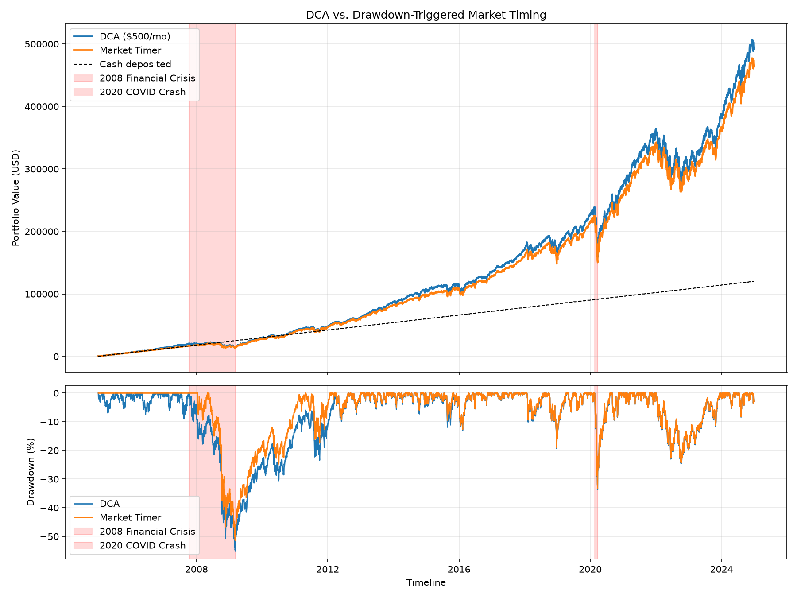

# DCA vs. Market Timing: 20-Year Backtest on the S&P 500

## Summary
**Question:** With identical monthly deposits, does waiting for a 10% dip
beat investing immediately every month?

**Method:** Python backtest on 20 years of SPY (dividend-adjusted) comparing
monthly dollar-cost averaging to a drawdown-triggered timer that holds cash
until a dip.

**Finding:** *[One sentence, written AFTER you run it, using your real numbers.]*

## Results
                           

| Metric | DCA | Timer |
| :--- | ---: | ---: |
| Final value ($) | 491,626.59 | 463,669.47 |
| Cash deposited ($) | 120,000.00 | 120,000.00 |
| Leftover cash ($) | 0.00 | 10,500.00 |
| Total return (x) | 3.10x | 2.86x |
| XIRR (annualized) | 12.55% | 12.07% |
| Max drawdown | -55.19% | -51.47% |
| Trades | 240 | 57 |

## Methodology
- Data: SPY via yfinance, auto-adjusted for dividends and splits
- DCA: $500 on the first trading day of each month
- Timer: $500 monthly goes to cash; the full bucket is deployed when price
  is 10%+ below its trailing 252-day high
- Signals are lagged one trading day to avoid look-ahead bias
- Both strategies start after a 252-day warm-up so they cover identical periods

## Assumptions
Fractional shares, zero transaction costs, no taxes, 0% interest on cash.

## Metrics
Total return, XIRR (timing-aware annualized return), max drawdown on a
flow-adjusted index (deposits excluded), and trade count.

## Robustness
To no ones surprise, investing a fixed amount every month beat waiting for market dips in every test I ran, 
because the money sitting in cash missed out on the market’s long-term growth. 
The more strictly the strategy defined a “dip,” the more it lost, with the worst version ending about 22% behind.
## Limitations
- One historical path, US large-cap in a strong era
- Cash earns 0%, which favors DCA
- Results may not generalize to other markets or periods

## Run it
    pip install -r requirements.txt
    python main.py
    python sensitivity.py
    pytest